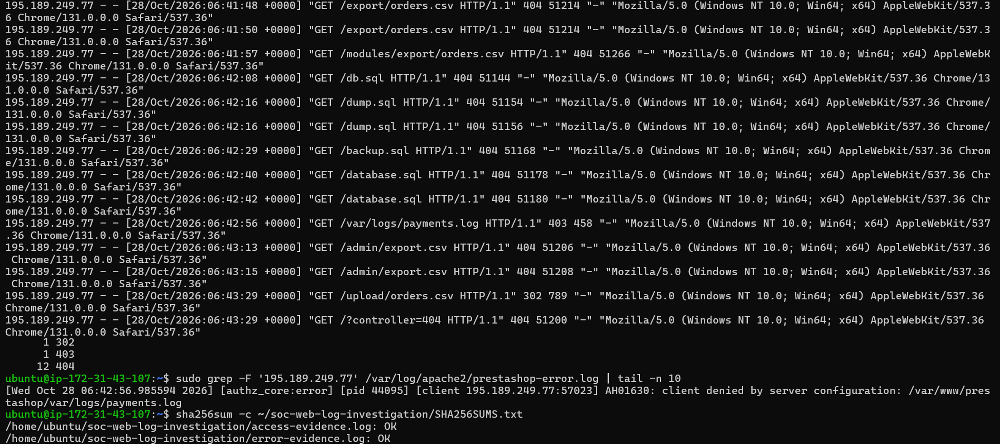

# Investigating Suspicious Web Requests in Apache Logs

## Overview

I investigated suspicious requests recorded by the Apache web server hosting my AWS PrestaShop demo store.

I identified a source requesting database backups, order exports and a possible payment log. I examined the requests, checked their response codes and correlated a forbidden response with the Apache error log.

This was a guided learning investigation using activity recorded on my own lab server. I used external learning resources, documentation and AI guidance to support the investigation, develop commands and interpret results. I checked the findings against the access and error log entries.

## Investigation Questions

- Was the visitor browsing normally or probing for exposed sensitive files?
- Did the available evidence show successful retrieval?
- Did the error log explain any of the responses?

## Environment and Tools

- AWS EC2, Ubuntu and Apache.
- PrestaShop demo application.
- Apache access and error logs.
- Linux tools: awk, sort, uniq, grep, zgrep and sha256sum.
- SSH for server access and SCP for evidence transfer.

## Findings

On 28 October 2026, source IP `195.189.249.77` made 14 requests between **06:41:48 and 06:43:29 UTC**, a period of 101 seconds.

Requested paths included:

- `/export/orders.csv`
- `/modules/export/orders.csv`
- `/db.sql`
- `/dump.sql`
- `/backup.sql`
- `/database.sql`
- `/var/logs/payments.log`
- `/admin/export.csv`
- `/upload/orders.csv`

The pattern is consistent with probing for exposed data exports, backups and logs rather than ordinary storefront browsing.

The IP address is an investigation indicator. It does not identify the person or organisation responsible.

## HTTP Response Summary

| Status | Count | Meaning |
| --- | ---: | --- |
| 404 | 12 | Server reported the resource was not found |
| 403 | 1 | Server refused access |
| 302 | 1 | Server returned a redirect |
| Total | 14 | Requests examined |

No 2xx success responses appeared in this set.

## Timeline

All times are UTC on 28 October 2026.

| Time | Observation |
| --- | --- |
| 06:41:48–06:41:57 | Requests for order exports returned 404 |
| 06:42:08–06:42:42 | Requests for SQL backup filenames returned 404 |
| 06:42:56 | `/var/logs/payments.log` returned 403 |
| 06:43:13–06:43:15 | `/admin/export.csv` requests returned 404 |
| 06:43:29 | `/upload/orders.csv` returned 302 |
| 06:43:29 | A subsequent request to `/?controller=404` returned 404 |

The final two requests are consistent with a redirect to an error page. The access log does not record the Location header, so the redirect destination was not directly verified.

## Access and Error Log Correlation

At 06:42:56, the error log recorded this message for the same source IP:

> AH01630: client denied by server configuration

The timestamp, source address and requested path match the 403 response for `/var/logs/payments.log`.

This confirms that Apache's configuration denied that request. It does not prove that the requested file exists.

## Investigation Process

1. Listed the available Apache logs.
2. Reviewed recent requests to understand the log format.
3. Ranked source IPs by request count.
4. Examined the highest-count source's paths and request timing.
5. Counted its HTTP response codes.
6. Correlated the forbidden request with the error log.
7. Searched current and rotated access logs for additional matches.
8. Saved relevant log extracts and generated SHA-256 checksums.
9. Verified the extracts and downloaded them using SCP.

The search across available current and rotated access logs returned the same 14 matching entries.

## Evidence Preservation

I saved the following files:

- `access-evidence.log`: 14 matching access-log entries.
- `error-evidence.log`: one matching error-log entry.
- `SHA256SUMS.txt`: SHA-256 checksums for both extracts.

Both extracts passed checksum verification on the server. Their hashes also matched after downloading and uploading them for review.

These are selected evidence extracts, not a complete forensic acquisition. The checksums allow changes to the saved extracts to be detected against the recorded values; they do not independently prove the original logs are authentic or complete.

## Assessment

The activity is consistent with suspicious file enumeration targeting potentially sensitive exports, backups and logs.

The reviewed responses do not demonstrate successful retrieval of those files. Apache explicitly denied one request.

This conclusion applies only to the evidence reviewed. It does not establish that the entire server is free from compromise.

## Recommended Follow-Up

- Keep sensitive backups, exports and logs outside publicly served directories.
- Review application and Apache access controls.
- Monitor repeated requests for sensitive filenames.
- Review wider activity if further suspicious indicators appear.
- Improve log retention and centralised monitoring.
- Maintain patching and configure HTTPS.

These are recommendations. No IP blocking or configuration changes were performed during this investigation.

## Lessons Learned

- Request volume alone does not establish malicious activity.
- Paths, timing and response codes provide important context.
- Access and error logs can corroborate each other.
- A 403 does not prove a file exists.
- A redirect does not prove a download succeeded.
- Findings should distinguish observations from interpretation.
- Evidence should be preserved before making changes.

## Evidence Files

- [Access-log extract: 14 requests](access-evidence.log)
- [Error-log extract: matching Apache denial](error-evidence.log)
- [Original SHA-256 checksum manifest](SHA256SUMS.txt)

The original manifest contains absolute paths from the Ubuntu server. After downloading the files, verify their contents from the download directory with:

```bash
sha256sum access-evidence.log error-evidence.log
```

Compare the resulting hashes with those in the manifest. The different local paths do not affect the file hashes.

## Terminal Evidence

Combined cropped excerpts from the investigation screenshots showing the requests, response counts, matching Apache denial and successful checksum verification.


